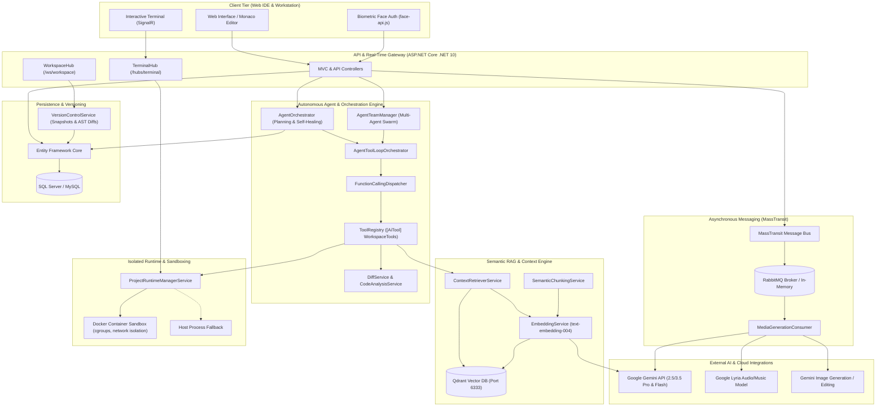

# Btoan AI Studio — Autonomous AI Software Engineering & Multimodal Platform

[](https://dotnet.microsoft.com/)
[](https://learn.microsoft.com/dotnet/csharp/)
[](https://learn.microsoft.com/ef/core/)
[](https://masstransit.io/)
[](https://qdrant.tech/)
[](https://www.docker.com/)

> An enterprise-grade autonomous software engineering platform and multimodal workstation built with **ASP.NET Core (.NET 10)**. The platform enables multi-agent task planning, self-healing code synthesis, sandboxed container execution, high-dimensional vector search (Qdrant RAG), and resilient asynchronous messaging.

---

## 1. System Architecture

The following architecture diagram illustrates the end-to-end data pipeline, agent execution loops, messaging topology, and external service integrations:



---

## 2. Tech Stack

| Domain | Technologies & Libraries |
| :--- | :--- |
| **Backend Framework** | C# 13, ASP.NET Core 10.0 (Web SDK), Minimal APIs & MVC |
| **Data & ORM** | Entity Framework Core 9.0, Microsoft SQL Server, Pomelo MySQL |
| **Vector DB & RAG** | Qdrant Vector Engine (REST API), Google `text-embedding-004` (768-dim), Semantic Chunking |
| **Agentic Framework** | Custom Native Tool Registry (`[AiTool]`), Recursive Tool Loop Orchestrator, Multi-Agent Planner |
| **Messaging & Queues**| MassTransit 8.3.6, RabbitMQ (with automatic In-Memory dev fallback) |
| **Real-time Comms** | Microsoft ASP.NET Core SignalR (WebSockets & Long Polling) |
| **Sandboxing & DevOps**| Docker Engine API / CLI, Linux alpine multi-stage containers, Render / Koyeb YAML specs |
| **Frontend & UI** | Monaco Editor, Vanilla ES6+, CSS3 Grid/Flexbox, `face-api.js` (TensorFlow.js models) |

---

## 3. Key Engineering Highlights

### 1. Autonomous Agent Tool Loop & Self-Healing Workflows
- **Dynamic Tool Dispatching**: Services register operations using attribute-driven reflections (`[AiTool]`), automatically exposing schema-valid function definitions to Gemini.
- **Automated Self-Healing**: When executing generated code or tests inside the sandbox, runtime errors (e.g., compile issues, missing packages) are piped directly back into the LLM context loop for iterative self-correction (configurable retry limit).
- **Dual Execution Modes**:
  - `AUTO`: Agents autonomously plan subtasks, mutate code, build, test, and commit.
  - `SAFE`: Agent changes generate structured AST diffs (`AgentChangeDto`) requiring human sign-off before being committed to disk.

### 2. Multi-Tier Containerized Sandboxing
- **Resource Constraints**: Arbitrary code execution is isolated within ephemeral Docker containers with strict limits on RAM (512MB default), CPU shares (`1.0`), maximum PIDs (`64`), and disabled network egress.
- **Graceful Fallback**: If the Docker daemon is unreachable, the system gracefully falls back to a restricted operating system process runner with strict execution timeouts (45 seconds) and safe working directories.

### 3. Semantic Retrieval-Augmented Generation (RAG)
- **High-Dimensional Embeddings**: Indexes project files into a 768-dimensional vector space using Google's `text-embedding-004` model.
- **Qdrant Vector Database**: Enables Sub-millisecond Approximate Nearest Neighbor (ANN) cosine similarity queries to dynamically inject the most relevant codebase context into LLM system prompts.

### 4. Resilient Asynchronous Event Bus (MassTransit)
- **Decoupled Heavy Compute**: Long-running multimodal generative workloads (music synthesis via Lyria, video generation, image editing) are published as messages (`GenerateMusicCommand`, `GenerateImageCommand`) via MassTransit.
- **Failover Architecture**: Supports RabbitMQ broker for production clusters and seamlessly transitions to an In-Memory bus when running in local development mode without configuration.

### 5. Bidirectional Real-Time Streaming
- **Terminal Hub (SignalR)**: Streams standard output (`stdout`), standard error (`stderr`), and exit codes from inside running Docker containers to the client-side terminal in real time.
- **Workspace Hub**: Synchronizes live file-tree changes, active agent thought streams, and git-like snapshot histories across connected client sessions.

---

## 4. Repository Structure

```
ai-project/
├── Controllers/              # MVC and REST API endpoints (Agents, Runtimes, Chat, Deployments)
├── Data/                     # Entity Framework AppDbContext and model configs
├── FunctionCalling/          # Custom Tool Registry, Dispatcher, and [AiTool] definitions
│   ├── Attributes/           # AiToolAttribute for zero-boilerplate reflection
│   ├── Services/             # ToolRegistry and FunctionCallingDispatcher
│   └── Tools/                # WorkspaceTools (file I/O, search, git, bash)
├── Hubs/                     # SignalR Hubs (TerminalHub, WorkspaceHub)
├── Messaging/                # MassTransit message contracts and consumers
│   ├── Commands/             # Media generation commands
│   └── Consumers/            # MediaGenerationConsumer for async jobs
├── Models/                   # Domain entities (Projects, AgentTasks, Versions, Deployments)
├── Repositories/             # Repository pattern implementations for data access
├── Services/                 # Core domain logic
│   ├── VectorDb/             # Qdrant client, EmbeddingService, SemanticChunkingService
│   ├── AgentOrchestrator.cs  # High-level autonomous workflow engine
│   ├── AgentTeamManager.cs   # Multi-agent role assignment & communication
│   ├── RuntimeService.cs     # Docker & process execution sandboxing
│   └── GeminiService.cs      # Resilient Google Gemini API client
├── wwwroot/                  # Static assets (IDE UI, Monaco editor, face-api model shards)
├── Dockerfile                # Multi-stage production container build
├── appsettings.Example.json  # Sanitized configuration template
└── .env.example              # Environment variables template
```

---

## 5. Getting Started

### Prerequisites
- [.NET 10 SDK](https://dotnet.microsoft.com/)
- [Docker Desktop](https://www.docker.com/) (optional, required for container sandboxing)
- [Qdrant](https://qdrant.tech/) (optional, required for semantic vector search)
- SQL Server (LocalDB / Express) or MySQL 8.0+

### Configuration

1. Copy the configuration template:
   ```bash
   cp appsettings.Example.json appsettings.json
   # or copy environment template
   cp .env.example .env
   ```
2. Configure your **Google Gemini API Key** in `appsettings.json` or via environment variable:
   ```json
   {
     "Gemini": {
       "ApiKey": "YOUR_GEMINI_API_KEY_HERE"
     }
   }
   ```
   *(Alternatively, export `GEMINI_API_KEY=YOUR_GEMINI_API_KEY_HERE`)*.

3. (Optional) Run Qdrant Vector Engine via Docker:
   ```bash
   docker run -d -p 6333:6333 -p 6334:6334 qdrant/qdrant
   ```

### Running Locally

```bash
# 1. Restore dependencies
dotnet restore

# 2. Build project
dotnet build

# 3. Run application
dotnet run --project BtoanAiNet.csproj
```

Navigate to `http://localhost:5000` (or `http://localhost:8080`) in your browser.

### Running with Docker

```bash
# Build the Docker image
docker build -t btoan-ai-studio .

# Run the container
docker run -d -p 8080:8080 -e GEMINI_API_KEY="YOUR_API_KEY" btoan-ai-studio
```

---

## 6. License & Author

- **Author**: Nguyễn Bảo Toàn ([@btoan2802](https://github.com/btoan2802))
- **License**: MIT License
